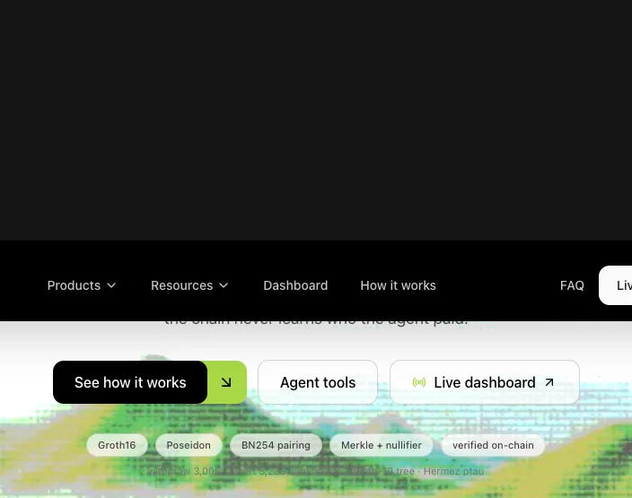
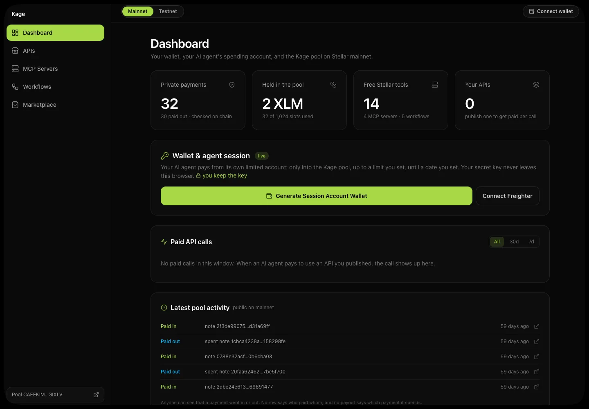
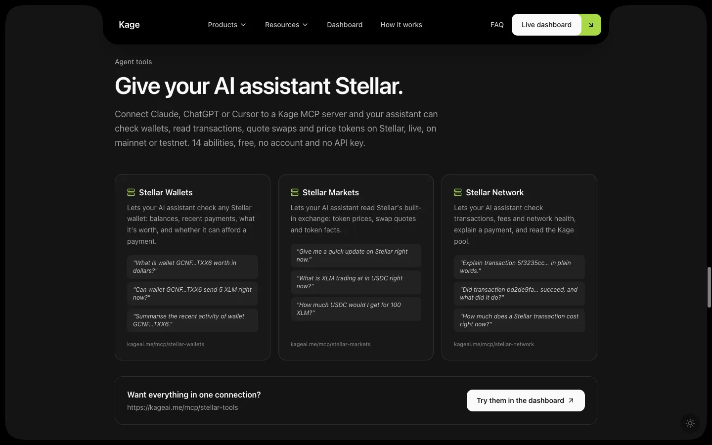
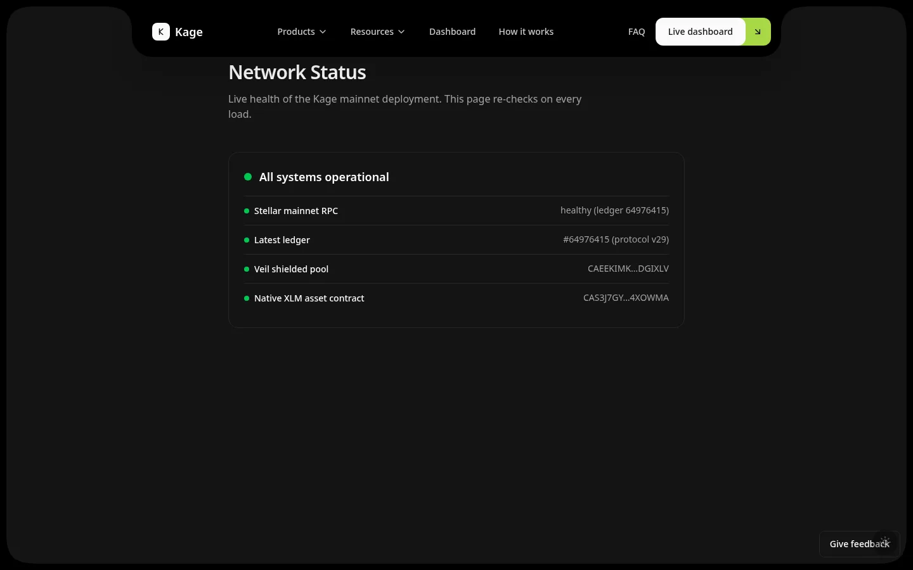

<div align="center">

# KAGE

### Stellar tools and private payments for AI agents: MCP servers that read the chain live, and a session key the agent can't drain that pays through a zero-knowledge pool.

[](https://kageai.me)
[](https://stellar.expert/explorer/public/contract/CAEEKIMKQVRDX6NH2RZIRGWOUF4VDGL6OPF2MGNQ3V2TIGPYJNDGIXLV)
[](https://github.com/Venkat5599/kagezks/actions)
[](LICENSE)

[](https://x.com/Kage_stellar)


**[ Live app ↗ ](https://kageai.me)** · **[ Developer tooling ↓ ](#developer-tooling)** · **[ Network status ↗ ](https://kageai.me/status)** · **[ Verify every claim ↓ ](#verify-every-claim-in-one-command)** · **[ 30-day scope ↗ ](docs/SPRINT-SCOPE.md)**

</div>

An AI agent that works on Stellar needs two things: a way to see the chain and a way to pay on it. Kage gives it both.

**To see**, an assistant connects to one of four Kage MCP servers and gets 14 live tools: wallet balances, recent payments, transaction lookups, fees, network health, token prices, swap quotes from the Stellar DEX, token facts and the Kage pool, on mainnet or testnet. They are free and need no account or API key, so Claude, ChatGPT or Cursor can answer "what is this wallet worth?" from the ledger instead of guessing.

**To pay**, the agent signs with a **scoped session key** that a Soroban account contract confines to one action (deposit into the pool, up to a cap, before an expiry), and every payment settles through a **Groth16 shielded pool** where the payee later proves, in zero knowledge, that it owns *some* note without revealing which. The chain sees commitments, random ephemeral keys, a Merkle root and nullifier hashes. It never sees who paid whom.

The pool is live on Stellar mainnet and holds real XLM. The BN254 pairing check runs inside the contract, on chain, on every deposit and every withdrawal: 32 deposits and 30 withdrawals so far, every one verified that way.

```
SCOPED  ≠  CUSTODIED          the agent can pay, it cannot drain or redirect
PAID    ≠  LINKED             a withdrawal never names the deposit it spends
PROVEN  ≠  TRUSTED            the pool verifies every root change itself; nobody vouches for the tree
READ    ≠  GUESSED            the assistant answers from live ledger data through MCP tools
```

## Live status

| Surface | Status | The evidence |
|---|---|---|
| Shielded pool (mainnet) | ✅ live | [`CAEEKIM…GIXLV`](https://stellar.expert/explorer/public/contract/CAEEKIMKQVRDX6NH2RZIRGWOUF4VDGL6OPF2MGNQ3V2TIGPYJNDGIXLV) — `leaf_count = 32` at ledger 65093036; 32 deposits, 30 withdrawals in its event history |
| Shielded pool (testnet) | ✅ live | [`CCQWGM…GJXC`](https://stellar.expert/explorer/testnet/contract/CCQWGM2CBTFTY4B3OTKNTQO3GMBJUHWTJOSU7NC2QRDZ26KCSMJQGJXC) — `leaf_count = 8`; the dashboard switches to it in one click |
| Agent payments (testnet) | ✅ 7 payments | 7 pool deposits each authorised by an agent's SessionAccount, not a person: `CB3A5Q…F636` ([`62902ef7…29a95851`](https://stellar.expert/explorer/testnet/tx/62902ef7121b75ac3a9bed1e5013f7508daf56dc1811378487d1a92629a95851)), `CC7RGS…RYO7` ([`b80cc005…3e3b60a6`](https://stellar.expert/explorer/testnet/tx/b80cc0054674aa827b2edd960dd00d470e583bd83079290d91cc62b23e3b60a6)), `CBHD6A…CQB7` ([`380ae45d…c2772f1b`](https://stellar.expert/explorer/testnet/tx/380ae45d40ef1fd94512732639bd5218933209b61e2622902d62d93bc2772f1b)); each account's on-chain `spent` counter moved |
| Agent account setup | ✅ testnet | the owner signs in the browser and the server never sees the key; sessions `CBSIBR…CP65` and `CA4CN3…YOHX` created this way, 11 attack checks refused ([`scripts/provision-check.ts`](scripts/provision-check.ts)) |
| Stellar MCP servers | ✅ live | `kageai.me/mcp/stellar-tools` answers `tools/list` with 14 tools; three focused servers alongside it |
| Mainnet transactions | ✅ 101 / 101 successful | 20 wallets × 5 txs + 1 fee-sponsored tx, re-read from Horizon by [`scripts/verify-mainnet.sh`](scripts/verify-mainnet.sh) |
| Web app | ✅ live | [kageai.me](https://kageai.me) — Next.js on Vercel, Neon Postgres |
| Agent fabric (MCP) | ✅ live | `https://kageai.me/fabric/mcp` answers `initialize`; `/fabric/health` reports the mainnet pool |

## The 20-second pitch

Agents are starting to do real work on chains: check balances, read payments, price tokens, pay for APIs and compute. Today an assistant asked about a Stellar wallet guesses, because it can't read the ledger. And when it pays, a raw key is a custody risk and every payment is public. The usual fix is a server that holds the key and promises to behave.

**Kage gives the agent eyes and a wallet it can't empty.** Fourteen MCP tools read Stellar live for any assistant. Payments go through a session key whose scope is enforced by the account contract's `__check_auth`, into a pool whose privacy is enforced by a zero-knowledge proof the contract verifies itself. The agent never holds anything it could drain, and an observer of the ledger never learns the payee.

```
Raw key on a public chain:   Agent ──► Wallet ──► Ledger            drainable · fully public

With Kage:                   Agent ──► SessionAccount ──► ZK pool ──► Ledger
                                       (cap · expiry ·    (insert proof     (commitments, R,
                                        pool-only)         + amount bound)   roots, nullifiers)

Payee, later:                scan R with view key ──► prove membership in ZK ──► withdraw to a one-time address
```

---

## Table of contents

- [Verify every claim in one command](#verify-every-claim-in-one-command)
- [Developer tooling](#developer-tooling)
- [Screenshots](#screenshots)
- [What Kage is NOT](#what-kage-is-not)
- [The problem I set out to solve](#the-problem-i-set-out-to-solve)
- [What I built](#what-i-built)
- [Architecture](#architecture)
- [The payment loop, step by step](#the-payment-loop-step-by-step)
- [Where the guarantee is enforced](#where-the-guarantee-is-enforced)
- [Why the ZK is load-bearing](#why-the-zk-is-load-bearing)
- [Engineering decisions & the traps that taught me something](#engineering-decisions--the-traps-that-taught-me-something)
- [Attack → test](#attack--test)
- [The app](#the-app)
- [Security](#security)
- [Tech stack](#tech-stack)
- [Project layout](#project-layout)
- [Run it yourself](#run-it-yourself)
- [How it's deployed](#how-its-deployed)
- [Roadmap](#roadmap)
- [Tests](#tests)
- [License](#license)

---

## Verify every claim in one command

Every mainnet figure in this README is re-derivable without a key. The script pulls each transaction hash from the proof files, asks Horizon whether it succeeded, then simulates a read of the pool's live leaf count:

```bash
bun install
bash scripts/verify-mainnet.sh
```

Real output, run while writing this README:

```
mainnet txs: 101/101 successful on Horizon (0 failed or missing)
pool CAEEKIMKQVRDX6NH2RZIRGWOUF4VDGL6OPF2MGNQ3V2TIGPYJNDGIXLV
  leaf_count = 32  (ledger 65093036)
```

The 101 hashes live in [`scripts/20-users-mainnet-proof.txt`](scripts/20-users-mainnet-proof.txt) (20 wallets, each funded → deposit → withdraw → two merges) and [`scripts/fee-sponsor-proof.txt`](scripts/fee-sponsor-proof.txt) (one gasless payment through a fee bump). One of each, if you would rather click:

| Step | What the chain checked | Transaction |
|---|---|---|
| Deposit | Groth16 insert proof (BN254 pairing), amount bound into the commitment, XLM pulled into the pool | [`bd2de9fa…9cd0d379`](https://stellar.expert/explorer/public/tx/bd2de9fa7612fbc1b8ac775cd29dcd13907ad1c29520c485363d295a9cd0d379) |
| Withdraw | Groth16 membership proof, nullifier unused, payout address bound into the proof | [`5f3235cc…19461793`](https://stellar.expert/explorer/public/tx/5f3235cc72dd7091d72fc652ecc7bbcfe4599db0663d75a2105e53da19461793) |
| Fee-sponsored payment | user signs with fee 0, sponsor wraps it in a fee bump | [`027cd20c…cd979397`](https://stellar.expert/explorer/public/tx/027cd20c2b04230ad8cfcb94962269bd815c51c29d175b40c3693f2fcd979397) |

## Developer tooling

Kage is also a toolkit for anyone building on Stellar with AI agents: live chain data any assistant can call, a sandbox for agent payments on testnet, and the checks we run against our own code, all usable without an account.

| Tool | What it gives a developer | Where |
|---|---|---|
| 4 MCP servers, 14 tools | wallets, payments, transactions, fees, network health, DEX prices and swap quotes, token facts, the Kage pool; mainnet or testnet per call | `https://kageai.me/mcp/<server>`, [below](#stellar-mcp-servers-and-apis) |
| 9 HTTP APIs + 5 workflows | the same tools as plain JSON, for code that isn't an assistant | `GET /api/catalog/<api>`, `GET /api/flows/<workflow>` |
| Readable server pages | opening an MCP URL in a browser lists every tool with a working example link | `https://kageai.me/mcp/stellar-tools` |
| Agent payment sandbox | one-click testnet switch, free test XLM, then an agent account created and signed in the browser that pays only into the testnet pool | `/dashboard` → Testnet |
| Live test suite | every API, workflow and MCP server against mainnet and testnet through a running deployment | `KAGE_URL=https://kageai.me npm run test:live` (in `frontend/`) |
| Setup attack checks | 11 ways to abuse agent-account setup (stolen-key signatures, inflated transfers, reordered or replayed approvals), each must be refused before any fee is spent | `FABRIC=<fabric url> bun run scripts/provision-check.ts` |
| Mainnet receipts check | re-reads every recorded mainnet transaction and the pool counter without a key | `bash scripts/verify-mainnet.sh` |

### Stellar MCP servers and APIs

Four MCP servers, all reading Stellar through Horizon and Soroban RPC with nothing to sign up for. Each tool takes `network: mainnet | testnet`.

| Server | URL | What an assistant can do with it |
|---|---|---|
| Stellar Tools | `https://kageai.me/mcp/stellar-tools` | everything below, 14 tools |
| Stellar Wallets | `https://kageai.me/mcp/stellar-wallets` | balances, recent payments, what a wallet is worth, can it afford a payment, activity summary |
| Stellar Markets | `https://kageai.me/mcp/stellar-markets` | token prices and swap quotes from the Stellar DEX (best path), token facts (holders, supply, freeze/clawback flags), a market snapshot |
| Stellar Network | `https://kageai.me/mcp/stellar-network` | explain a transaction, fees, network health, the Kage pool |

Tokens resolve only to their verified issuers (USDC and EURC from Circle, AQUA, yXLM) or to an explicit `CODE:ISSUER`, because Horizon lists every look-alike token with the same code.

Every tool is also plain HTTP, so code can call it too. Real output from this commit's build (prices move, so your numbers will differ):

```bash
$ curl -s "https://kageai.me/api/flows/wallet-worth?address=GCNFKDC4S3T3DOQ5FUBNUQSDOEQB74FGY7U6HGRSXZ3G7346JGOETXX6" | jq -r .answer
This wallet is worth about $0.48: 2.6955 XLM ($0.48).

$ curl -s "https://kageai.me/api/catalog/stellar-convert?amount=100&from=XLM&to=USDC" | jq -r '.data | "\(.youGet) via \(.route)"'
17.6841507 USDC via XLM → USDC
```

Connecting takes one step in each client: add the URL as a custom connector (Claude), an MCP app in developer mode with no authentication (ChatGPT), or `claude mcp add kage --transport http <url>` (Claude Code). Pasting the URL into a chat does not work; the client has to register it as a server. The dashboard's MCP pages walk through it and let you try every tool in the browser first.

## Screenshots

**Landing**: live at [kageai.me](https://kageai.me).


**What the chain sees**: the landing preview reads the pool's full event history: 32 payments in, 30 paid out, 2 XLM held, 32 of 1,024 slots used, and the latest events with explorer links.



**Dashboard**: the same numbers, the free tools, and the latest pool activity, switching with the mainnet/testnet toggle.



**Agent tools**: the MCP servers any assistant can connect to, with example questions for each.



**Network status**: `/status` re-checks the mainnet RPC, the latest ledger and both contracts on every load.



## What Kage is NOT

- **Not a custodial wallet.** No server holds a key that can move user funds. The fabric's relayer key pays network fees; the SessionAccount policy decides what value can move.
- **Not a mixer you send money through and hope.** The pool's state transitions are each checked by a proof on chain. A deposit that does not prove a correct tree append is rejected; a withdrawal that does not prove membership is rejected.
- **Not encryption on top of a server.** "Encrypt it and trust our backend" still trusts a backend. Here, scope lives in the account contract and unlinkability lives in the proof.

## The problem I set out to solve

| Hand an agent a raw key on a public chain… | Kage's answer |
|---|---|
| The agent, or whoever compromises it, can move **all** your funds | A SessionAccount: only `deposit`, only into the configured pool, up to a cap, before an expiry |
| Every payment publishes **counterparty and amount** | The agent→payee link is broken by a ZK membership proof at withdrawal |
| Paying the same payee twice links them forever | Each payment goes to a fresh one-time stealth address derived by ECDH |
| "Trust our server" | Scope enforced by `__check_auth`; the tree enforced by proofs the contract verifies |

## What I built

- **Veil pool** (`contracts/solvency/contracts/veil`) — a Soroban shielded pool. `deposit` verifies a Groth16 *insert* proof that the new Merkle root correctly appends the commitment and binds the deposited amount; `withdraw` verifies a Groth16 *membership* proof and spends a nullifier.
- **SessionAccount** (`contracts/solvency/contracts/session`) — a custom Soroban account. Its `__check_auth` accepts the agent's ed25519 signature only for `Veil.deposit` and a token transfer into the pool, under the remaining cap, before expiry. The owner can `extend` or `revoke`.
- **Two circuits** (`circuits/`) — `veil_insert.circom` (append proof with amount binding) and `veil_withdraw.circom` (membership, nullifier, amount range, recipient binding).
- **SDK** (`sdk/`) — stealth notes over X25519, the Poseidon tree, snarkjs → Soroban BN254 byte conversion, and `payThroughSession`, which builds the proof and signs the Soroban auth entry with the agent's session key.
- **Agent fabric** (`agent/`) — an MCP server agents connect to. Tools include `kage_pool_status`, `kage_quote`, `kage_budget`, `kage_pay`, `workflow_list` and `workflow_run`; paid tools are gated by an x402-style Stellar payment.
- **Stellar agent toolkit** (`frontend/lib/builtin-catalog.ts`, `frontend/lib/builtin-workflows.ts`) — 9 read APIs and 5 workflows that chain them into one plain answer, served as 4 MCP servers at `/mcp/<server>` and as plain HTTP at `/api/catalog/<api>` and `/api/flows/<workflow>`.
- **Web app** (`frontend/`) — landing, a dashboard with a one-click mainnet/testnet switch, two wallets side by side (a generated session wallet and Freighter), the toolkit's API, MCP and workflow pages with live "try it" forms, a status page, and a client-side stealth address tool.

## Architecture

```
┌──────────────────────────────────────────────────────────────────────────┐
│ OWNER — funds the SessionAccount, sets the policy, can revoke            │
└───────────────────────────────┬──────────────────────────────────────────┘
                                │ delegates ONE ed25519 session key
                                ▼
┌──────────────────────────────────────────────────────────────────────────┐
│ SESSIONACCOUNT (Soroban custom account)                                   │
│   __check_auth: agent may ONLY                                            │
│     · call deposit on the configured pool        else ContextNotAllowed   │
│     · move the token, into that pool only        else BadPayout           │
│     · up to the remaining cap                    else CapExceeded         │
│     · before expiry                              else Expired             │
└───────────────────────────────┬──────────────────────────────────────────┘
                                │ agent signs the Soroban auth entry
                                ▼
┌──────────────────────────────────────────────────────────────────────────┐
│ VEIL POOL — mainnet CAEEKIMKQVRDX6NH2RZIRGWOUF4VDGL6OPF2MGNQ3V2TIGPYJNDGIXLV │
│   deposit(C, R, amount, proof)          withdraw(proof, root, nf, payout)  │
│     · old_root == current else #6         · root seen before else #8       │
│     · leaf_index == count else #7         · nullifier unused else #9       │
│     · insert proof (BN254) else #5        · membership proof else #5       │
│     · pull XLM via SAC                    · pay one-time stealth address   │
│   chain stores: commitments · R · roots · nullifier hashes                 │
└──────────────────────────────────────────────────────────────────────────┘
```

| Component | Where | Role |
|---|---|---|
| Veil pool | `contracts/solvency/contracts/veil/src/lib.rs` | tree root, root history, nullifier set, on-chain Groth16 verification |
| SessionAccount | `contracts/solvency/contracts/session/src/lib.rs` | policy-gated auth for the agent key |
| Insert circuit | `circuits/veil_insert.circom` | proves `old_root → new_root` appends `commitment` at `leaf_index`, binds `amount` |
| Withdraw circuit | `circuits/veil_withdraw.circom` | proves membership, derives the nullifier, binds recipient and amount |
| On-chain engine | `sdk/kage-onchain.ts` | proof generation, auth-entry signing, submission |
| Network config | `sdk/network.ts` | one switch for passphrase, RPC, Horizon and deployment IDs (default mainnet) |
| Fabric server | `agent/fabric-server.ts` | MCP over Streamable HTTP, provisioning, workflow runs |

**HTTP surface** (all on `kageai.me`):

| Route | What it does |
|---|---|
| `POST /fabric/mcp` | MCP endpoint for agents (public; settling still needs a per-agent bearer token) |
| `GET /fabric/health` | fabric liveness + the pool it is bound to |
| `GET /api/stats` | live pool read (leaf count) + builder totals |
| `GET /api/wallet-status?address=G…&network=` | native XLM balance from Horizon, either network |
| `POST /mcp/<server>` | the four Stellar MCP servers (`stellar-tools`, `stellar-wallets`, `stellar-markets`, `stellar-network`) |
| `GET /api/catalog/<api>?…` | any toolkit API as plain JSON |
| `GET /api/flows/<workflow>?…` | any toolkit workflow: `{ answer, details, steps }` |
| `GET /api/pool-activity` | the pool's full deposit and withdrawal history |
| `POST /api/friendbot` | free testnet XLM for a new wallet |
| `GET /api/session-account?id=C…&network=` | an agent account's live limit, spent, balance and expiry |
| `POST /api/fabric/provision` | agent account setup in two steps (`prepare` → plan with unsigned approvals, `finish` → signed approvals); refuses any secret key |
| `GET /status` | RPC, ledger and contract health, re-checked per load |

## The payment loop, step by step

1. **Publish.** The payee publishes a scan key `V` once (the `/tools/stealth` page generates one in the browser).
2. **Derive.** The agent picks a random `r`, computes `shared = r·V`, and derives the note secrets and commitment from `shared`. Only the ephemeral `R = r·G` is announced.
3. **Prove the append.** The agent builds the new Merkle root off chain and a Groth16 insert proof over `[old_root, new_root, commitment, leaf_index, amount]`.
4. **Deposit through the session.** The agent signs the Soroban auth entry with its session key. `__check_auth` on the SessionAccount checks method, destination, cap and expiry; the pool checks the proof with the BN254 host functions and pulls the XLM.
5. **Recognise.** The payee scans announced `R` values, recomputes `shared = v·R`, and finds the leaves that are theirs.
6. **Withdraw unlinkably.** The payee proves membership of *some* leaf under a known root, reveals only a nullifier hash, and binds a fresh one-time payout address into the proof.

## Where the guarantee is enforced

| Guarantee | Enforced in | Covered by |
|---|---|---|
| Agent can only deposit into the pool | `contracts/solvency/contracts/session/src/lib.rs` `__check_auth` → `ContextNotAllowed`, `BadPayout` | `payout_anywhere_but_the_pool_is_bad_payout`, `calling_withdraw_on_the_pool_is_refused`, `calling_any_other_contract_is_refused`, `token_methods_other_than_transfer_are_refused` |
| Agent cannot exceed its cap | `__check_auth` → `CapExceeded`, spend persisted per call | `one_payment_over_the_cap_is_refused`, `spending_adds_up_across_payments_until_the_cap`, `several_transfers_in_one_call_count_together` |
| Agent cannot outlive its expiry or a revoke | `__check_auth` → `Expired` | `session_after_expiry_is_refused`, `session_works_up_to_and_including_expiry`, `revoked_session_cannot_pay` |
| Only the agent's key can sign | `ed25519_verify` over the auth payload | `a_different_key_cannot_sign_for_the_agent`, `a_signature_over_another_payload_is_refused` |
| One bad call voids the whole batch | `__check_auth` checks every context before saving | `one_bad_call_rejects_the_whole_batch` |
| Policy cannot be re-initialised by someone else | `init` → `AlreadyInitialized` | `init_is_idempotent` (session) |
| Tree only advances by a correct append | `contracts/solvency/contracts/veil/src/lib.rs` `deposit` → `StaleRoot`, `BadLeafIndex`, `InvalidProof` | `deposit_rejects_bad_leaf_index` |
| No proof verification without a registered key | `deposit` → `NoVerificationKey` | `deposit_without_vk_fails` |
| Withdrawals only against a real past root | `withdraw` → `UnknownRoot` | `withdraw_rejects_unknown_root` |
| A note is spent once | `withdraw` → `NullifierUsed (#9)` | mainnet: every withdraw in the proof file spends a distinct nullifier |
| What is deposited is exactly what can be withdrawn | amount is a public input of the insert proof | under-funded deposits fail to prove (constraint violation) |
| The server never holds the owner's key | `frontend/lib/session-sign.ts` signs in the browser; `agent/fabric/provision.ts` verifies the signatures | `frontend/tests/session-sign.test.ts`, [`scripts/provision-check.ts`](scripts/provision-check.ts) |

## Why the ZK is load-bearing

- **Remove the membership proof** and each withdrawal has to name the deposit it spends. The agent's whole payment graph becomes public.
- **Remove the nullifier** and a note can be claimed twice, which drains the pool.
- **Remove the recipient binding** and anyone watching the mempool can copy a payee's proof and redirect the payout.
- **Remove the insert proof** and someone has to be trusted to compute the tree. Stellar's host Poseidon2 uses different constants from circomlib's Poseidon, so the contract cannot recompute the circuit's root itself; the insert proof is how it stays trustless anyway.

## Engineering decisions & the traps that taught me something

- **No on-chain Poseidon, so the tree is proven instead of recomputed.** The contract checks `old_root == current`, runs one pairing check, and advances. It costs a second circuit, and it removes the custodian.
- **The amount had to go into the insert proof.** An early version accepted a commitment and an amount separately, which meant the pool's balance and the notes inside it could drift apart. Binding `amount` as a public input made "deposited = withdrawable" arithmetic rather than bookkeeping.
- **Custom-account signatures are built by hand.** The SessionAccount takes a `BytesN<64>` ed25519 signature over the auth payload, so `sdk/kage-onchain.ts` constructs the signature `ScVal` to match the contract exactly. This was the hop that took longest to get right.
- **RPC event retention is not a database.** Public RPC drops deposit events after a window, which broke tree reconstruction for the next depositor. The SDK keeps a local leaf store and seeds from the known genesis leaf when events have aged out.
- **The public fabric cannot be a faucet.** Provisioning and workflow runs spend the relayer's XLM, so the reverse proxy only forwards them with a gateway token the web app holds; the MCP endpoint itself stays public, and settling still requires a per-agent bearer token.

## Attack → test

| The abuse | What answers it |
|---|---|
| Agent tries to send funds anywhere but the pool | `BadPayout` (`payout_anywhere_but_the_pool_is_bad_payout`) |
| Agent calls `withdraw` or any other contract with its session | `ContextNotAllowed` (`calling_withdraw_on_the_pool_is_refused`, `calling_any_other_contract_is_refused`) |
| Agent splits an overspend into small payments, or several transfers in one call | `CapExceeded` (`spending_adds_up_across_payments_until_the_cap`, `several_transfers_in_one_call_count_together`) |
| Agent keeps spending after the owner revokes | `Expired` (`revoked_session_cannot_pay`) |
| A stolen or different key signs for the agent | signature check fails (`a_different_key_cannot_sign_for_the_agent`) |
| Attacker re-initialises the policy with their own key | `AlreadyInitialized` (`init_is_idempotent`) |
| Depositor submits a root that skips or overwrites a leaf | `BadLeafIndex` / `StaleRoot` / `InvalidProof` (`deposit_rejects_bad_leaf_index`) |
| Withdrawal against a fabricated root | `UnknownRoot` (`withdraw_rejects_unknown_root`) |
| Same note withdrawn twice | `NullifierUsed (#9)` |
| Mempool watcher copies a withdrawal proof to redirect it | recipient is a public input of the proof → `RecipientMismatch` / `InvalidProof` |
| A tampered server asks the browser to sign a bigger transfer or a different pool | the browser refuses before signing (24 refusal cases in `frontend/tests/session-sign.test.ts`) |
| Someone posts a wallet's secret key to the setup endpoint | refused outright, by the web route and the fabric (`scripts/provision-check.ts`) |
| Stranger calls `/fabric/provision/*` to burn relayer XLM | reverse proxy returns 403 without the gateway token; `finish` verifies the owner's signatures and balance before any fee is spent |

## The app

[kageai.me](https://kageai.me) is the landing page, the dashboard (`/dashboard`), a network status page (`/status`), an API reference (`/docs`), and a client-side stealth address tool (`/tools/stealth`). The dashboard switches between mainnet and testnet in one click; every balance, pool read, payment and explorer link follows it, and on testnet a new wallet can be funded from friendbot. It holds a browser-generated session wallet and a Freighter wallet side by side, and the connect flow checks that Freighter is on the same network as the app. The Marketplace lists every public API, workflow and MCP server, and each one opens a page where you can run it before connecting anything.

## Security

Setting up an agent account never sends the owner's secret key anywhere: the server prepares two approvals, the browser checks that they say exactly what the user asked for, signs them locally and returns only the signatures, and the server verifies each signature before spending a fee. The contracts have been through a maintainer self-review covering ZK soundness (verification uses Soroban's native BN254 host functions: `g1_msm`, `g1_add`, `pairing_check`), double-spend protection, ordering of state writes before token transfers, and the SessionAccount policy. No critical issues were found. Report issues privately through GitHub security advisories on this repository.

## Tech stack

- **Contracts:** Soroban (Rust, `soroban-sdk` 26)
- **Zero knowledge:** Circom + snarkjs, Groth16 over BN254, circomlib Poseidon
- **Stealth notes:** X25519 ECDH one-time addresses
- **SDK / agent:** Bun, TypeScript, `@stellar/stellar-sdk`, `@noble/curves`, Model Context Protocol
- **Web:** Next.js 16, React 19, Tailwind v4, Freighter, Neon Postgres
- **Hosting:** Vercel (web), pm2 + Caddy on a VPS (fabric)

## Project layout

```
kagezks/
├── circuits/            veil_insert.circom · veil_withdraw.circom · build/ (vks, sample proofs)
├── contracts/solvency/  Soroban workspace: veil (pool) + session (scoped account), with tests
├── sdk/                 kage.ts (notes, tree) · kage-onchain.ts · kage-convert.ts · network.ts
├── agent/               fabric-server.ts (MCP) · fabric/ (auth, catalog, provision, steps) · x402.ts
├── frontend/            Next.js app served at kageai.me · tests/ (667 tests) · tests/live/
├── scripts/             deploy-mainnet.sh · verify-mainnet.sh · provision-check.ts · mainnet proof files
├── deploy/              Caddyfile · pm2 ecosystem · .env.example
└── docs/                SPRINT-SCOPE.md · screenshots/
```

## Run it yourself

```bash
git clone https://github.com/Venkat5599/kagezks.git && cd kagezks
bun install

# contracts + tests
cd contracts/solvency && cargo test && cd ../..

# circuits (needs circom; reuses the pot14 powers of tau)
bun run circuit:withdraw && bun run circuit:insert
bun run convert                      # snarkjs vk/proof -> Soroban BN254 bytes

# agent fabric against mainnet (fee payer secret in deploy/.env, see deploy/.env.example)
set -a; . deploy/.env; set +a
bun run fabric:serve                 # http://localhost:8403/mcp

# web app
cd frontend && npm install && npm run dev
```

## How it's deployed

- **Web:** `frontend/` on Vercel, with `DATABASE_URL` (Neon), `KAGE_FABRIC_URL=https://kageai.me/fabric` and `KAGE_FABRIC_GATEWAY_TOKEN`.
- **Fabric:** `bun run agent/fabric-server.ts` under pm2 on a VPS, env from `deploy/.env`.
- **Edge:** Caddy terminates `kageai.me`, sends `/fabric/mcp` and `/fabric/health` to the fabric, gates the rest of `/fabric/*` on the gateway token, and proxies everything else to Vercel. The block is in [`deploy/Caddyfile`](deploy/Caddyfile).

## Roadmap

The next 30 days and the product milestone after it, each item with a check anyone can run, are in [`docs/SPRINT-SCOPE.md`](docs/SPRINT-SCOPE.md).

| Phase | Focus | Status |
|---|---|---|
| 1 | ZK pool, SessionAccount, stealth notes | ✅ done |
| 2 | CI, tests, hardening, onboarding | ✅ done |
| 3 | Mainnet pool ✅ · Stellar agent toolkit (4 MCP servers, 14 tools) ✅ · mainnet/testnet switch ✅ · mainnet agent settlement · fixed denominations · multi-party setup | 🟡 in progress |
| 4 | One-command agent SDK, one-click MCP connect with OAuth, sign-in, non-custodial provisioning | ⬜ planned |
| 5 | Marketplace with real x402 services, private/public MCP servers, USDC pool, external audit, view/spend key split | ⬜ planned |

## Tests

```bash
cd contracts/solvency && cargo test      # 28 contract tests
cd frontend && npm test                  # 667 app tests, no network needed
cd frontend && npm run test:live         # every tool against the real networks
```

| Suite | Tests | What it covers |
|---|---|---|
| `session_account` | 23 | `__check_auth` with real ed25519 signatures: pool-only payouts, cap across payments and within one call, expiry, revoke and extend, foreign keys and payloads |
| `veil` | 5 | init, leaf-index and root checks, missing verifying key, unknown root |
| `frontend/tests/catalog-*.test.ts` | 329 | every API's inputs, outputs and failures against canned Horizon answers; catalog consistency |
| `frontend/tests/mcp-route.test.ts` | 56 | the MCP endpoint driven like an assistant: handshake, tool lists and schemas per server, calls, errors |
| `frontend/tests/tokens.test.ts` | 86 | official token issuers, look-alike rejection, asset encoding, operation descriptions |
| `frontend/tests/wallet-store.test.ts` | 53 | the browser never loses or overwrites a wallet key; the 4-character check before forgetting one |
| `frontend/tests/workflows.test.ts` | 41 | each workflow's answer and its step trace |
| `frontend/tests/networks.test.ts` | 31 | network config, including that each XLM contract is the real native-asset contract |
| `frontend/tests/session-sign.test.ts` | 27 | the browser refuses every tampered setup plan and signs the honest one |
| `frontend/tests/http-routes.test.ts`, `humanize.test.ts` | 44 | the plain HTTP routes, an agent account's live state, the pool history from a real mainnet event, answer labels |

Real output from this commit:

```
test result: ok. 23 passed; 0 failed; 0 ignored; 0 measured; 0 filtered out; finished in 0.10s
test result: ok. 5 passed; 0 failed; 0 ignored; 0 measured; 0 filtered out; finished in 0.03s
 Test Files  10 passed (10)
      Tests  667 passed (667)
```

The suites were checked against deliberate bugs: 15 breaks in the app (wrong reserve math, accepting look-alike tokens, overwriting a wallet key, dropping the pool history after one page, and others) and 6 in the session account (no payout check, no cap check, expiry off by one, any pool method allowed, spend not saved, signature not checked). Every one made tests fail. CI runs the contract tests, the app tests, the type-check and the build on every push.

## License

MIT. See [LICENSE](LICENSE).
